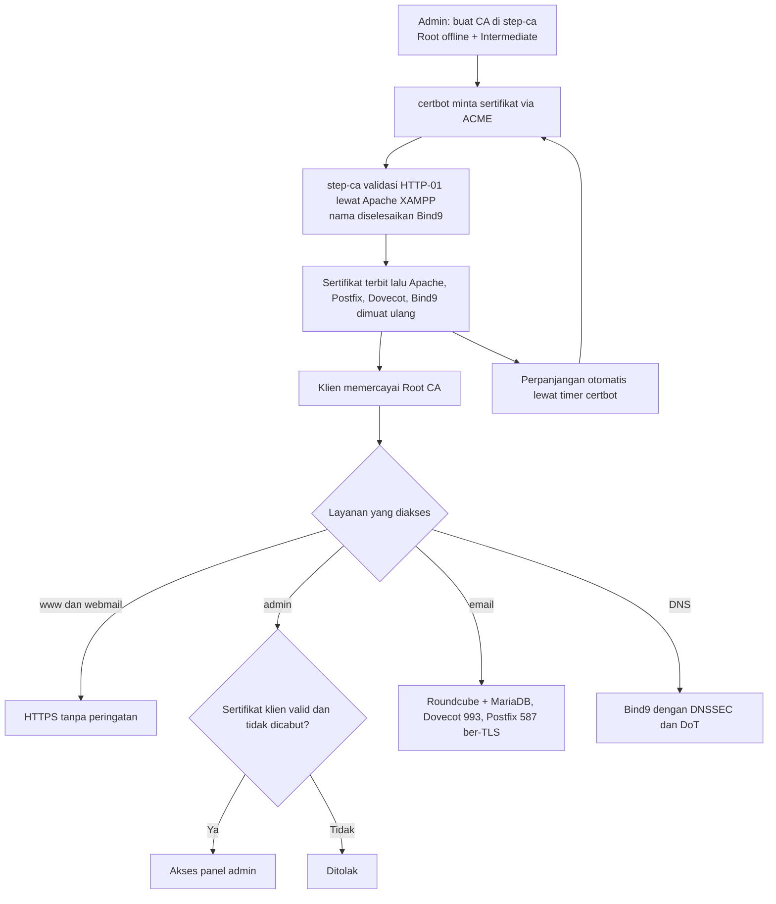

# PRD — Private PKI + Full HTTPS Internal

| Item | Isi |
|---|---|
| Nama proyek | Private PKI + Full HTTPS Internal (Certificate Authority sendiri) |
| Mata kuliah / konteks | Proyek kelompok Administrasi Server (Ubuntu Server) |
| Tim | 3 orang: A (PKI & Web), B (DNS & Infrastruktur), C (Mail & Dokumentasi) |
| Versi dokumen | 1.2 (web server dan database memakai XAMPP + MariaDB; diagram arsitektur dan alur; panduan instal-jalankan-integrasi) |
| Tanggal | 15 November 2026 |
| Tenggat proyek | 29 November 2026 (asumsi, perlu dikonfirmasi) |
| Dokumen pendamping | `Proyek-Private-PKI-Roadmap-dan-Panduan.md` (roadmap, langkah implementasi, jadwal) |
| Status | Draf untuk disetujui tim |

---

## 1. Ringkasan Eksekutif

Proyek ini membangun infrastruktur kunci publik (PKI) privat pada satu server Ubuntu 24.04. Sebuah Certificate Authority (CA) dua tingkat (Root dan Intermediate) menerbitkan sertifikat bagi seluruh layanan internal (web, panel admin, mail, webmail, DNS) melalui protokol ACME, sehingga penerbitan dan perpanjangan berjalan otomatis. Layanan admin dilindungi mTLS, sertifikat yang bocor dapat dicabut, dan DNS (Bind9) diperkuat dengan DNSSEC, DNS over TLS, dan record CAA.

**Nilai utama:** meniru praktik nyata perusahaan dan kampus yang tidak dapat memakai Let's Encrypt untuk domain internal, sekaligus memenuhi syarat tugas (≥ 2 aplikasi server baru, Bind9 wajib) dan kriteria penilaian (kompleksitas, jumlah aplikasi, demo, laporan).

---

## 2. Latar Belakang dan Masalah

### 2.1 Latar belakang
Tugas mensyaratkan kelompok memasang minimal 2 aplikasi server di Ubuntu Server yang disediakan. Bind9 wajib terpasang, aplikasi dari materi praktikum boleh dipakai ulang, namun minimal 2 aplikasi harus baru. Materi praktikum meliputi: instalasi Ubuntu Server, Samba, FTP (Ubuntu dan Windows), Web Server, DNS, Proxy, SARG, Mail Server, dan Webmin.

### 2.2 Masalah yang diangkat
1. Layanan internal tidak dapat divalidasi oleh CA publik karena domainnya tidak publik.
2. Sertifikat *self-signed* memunculkan peringatan "Not Secure" dan membiasakan pengguna mengabaikan peringatan keamanan.
3. Sertifikat yang dikelola manual sering kedaluwarsa karena lupa diperpanjang.
4. Halaman admin yang hanya dilindungi password rentan terhadap pencurian kredensial dan brute force.
5. Resolusi DNS yang tidak ditandatangani dan tidak terenkripsi dapat dipalsukan atau disadap.

### 2.3 Peluang
Dengan Private PKI, seluruh masalah di atas dapat diselesaikan dalam satu sistem yang terpadu, ringan sumber daya (step-ca hanya membutuhkan puluhan MB RAM), dan jarang dipilih kelompok lain.

---

## 3. Tujuan, Non-Tujuan, dan Metrik Keberhasilan

### 3.1 Tujuan (Goals)
| ID | Tujuan |
|---|---|
| G1 | Membangun hierarki CA: Root (kunci offline) dan Intermediate (online) |
| G2 | Menyediakan server ACME sendiri sehingga sertifikat terbit dan diperpanjang otomatis |
| G3 | Mengamankan semua layanan internal dengan TLS dari CA sendiri tanpa peringatan di klien yang memercayai Root |
| G4 | Membatasi akses panel admin hanya untuk pemegang sertifikat klien (mTLS) |
| G5 | Membuktikan pencabutan sertifikat klien efektif memblokir akses |
| G6 | Memperkuat Bind9 dengan DNSSEC, DoT, dan CAA |
| G7 | Mengamankan layanan mail (SMTP/IMAP) dan webmail dengan TLS dari CA sendiri |
| G8 | Menghasilkan laporan, slide, dan demo yang lengkap sebelum tenggat |

### 3.2 Non-tujuan (Non-Goals)
- Sertifikat untuk domain publik atau integrasi dengan CA publik.
- HSM, token perangkat keras, atau CA berkluster (high availability).
- Mail server produksi yang dapat mengirim ke internet (port 25 sering diblokir penyedia VPS).
- Sistem manajemen identitas pengguna terpusat (LDAP/SSO).
- Penyerahan layanan ke pengguna nyata di luar demo.

### 3.3 Metrik keberhasilan
| Metrik | Target |
|---|---|
| Layanan memakai sertifikat dari CA sendiri | 100% dari 5 nama layanan (`ns1`, `www`, `admin`, `webmail`, `mail`) |
| Pengujian lulus (matriks T01–T24) | ≥ 95% (target 100%) |
| Perpanjangan sertifikat otomatis berhasil | Terbukti pada demo (`renew`) |
| Percobaan akses admin tanpa sertifikat | 100% ditolak |
| Akses dengan sertifikat yang dicabut | 100% ditolak |
| Validasi DNSSEC | `delv` menampilkan *fully validated* |
| Reboot | Semua layanan aktif otomatis tanpa intervensi |
| Demo dari perangkat bersih | Berhasil dua kali berturut-turut pada latihan |
| Aplikasi baru | 8 (step-ca, step CLI, certbot, Roundcube, Fail2ban, chrony, XAMPP, MariaDB); layanan jaringan baru yang pasti: step-ca, Roundcube, MariaDB, target 4 dengan Unbound (syarat minimal: 2) |
| Penyelesaian | Semua MUST selesai pada 25 November (fitur beku) |

---

## 4. Pemangku Kepentingan dan Pengguna

| Peran | Siapa | Kepentingan |
|---|---|---|
| Penilai | Dosen / asisten laboratorium | Kompleksitas, jumlah aplikasi, demo, laporan |
| Tim pengembang | Anggota A, B, C | Menyelesaikan proyek tepat waktu dan memahami materi |
| Admin CA | Anggota A | Mengelola Root, Intermediate, provisioner, pencabutan |
| Admin DNS/Infrastruktur | Anggota B | Mengelola Bind9, firewall, Fail2ban |
| Admin Mail | Anggota C | Mengelola Postfix, Dovecot, Roundcube |
| Pengguna akhir (simulasi) | Penguji / penonton demo | Mengakses layanan lewat browser dan klien email |

### 4.1 Persona dan skenario penggunaan
- **Admin (Budi):** memiliki sertifikat klien, membuka panel admin lewat browser, dan sertifikatnya dicabut ketika laptopnya "hilang".
- **Pengguna kantor (Alice dan Bob):** membuka situs internal tanpa peringatan, mengirim email satu sama lain lewat webmail yang dienkripsi.
- **Admin sistem (tim):** tidak perlu memperpanjang sertifikat manual, cukup memantau timer dan log.
- **Penilai:** menyaksikan demo dan memeriksa laporan.

---

## 5. Ruang Lingkup

### 5.1 Dalam lingkup
Hierarki CA dan server ACME, Bind9 (zona, DNSSEC, DoT, CAA), XAMPP (Apache HTTPS/mTLS, PHP, MariaDB), certbot, Postfix dan Dovecot (TLS), Roundcube, Fail2ban, UFW, chrony, serta dokumentasi dan demo.

### 5.2 Prioritas (MoSCoW)
| Prioritas | Isi |
|---|---|
| **Must** | Bind9, step-ca (Root + Intermediate), ACME + certbot, XAMPP (Apache HTTPS), mTLS, Postfix + Dovecot TLS, Fail2ban, chrony, laporan, demo |
| **Should** | Revocation, DNSSEC, DoT, Roundcube + database MariaDB, CAA, Unbound (resolver tervalidasi DNSSEC; menambah layanan server baru) |
| **Could** | OCSP, DNS-01 via `nsupdate`, FTPS, Webmin dengan sertifikat CA, SPF/DKIM |
| **Won't (kali ini)** | HSM, CA kluster, domain publik, relay email ke internet |

---

## 6. Gambaran Solusi

### 6.1 Arsitektur tingkat tinggi
```
Klien (percaya Root CA, DNS → IP VPS)
   │  HTTPS / mTLS / SMTP-IMAP TLS / DoT
   ▼
┌──────────── 1 VPS Ubuntu 24.04 (8 GB RAM, 40 GB, 2 core) ────────────┐
│ Bind9 (ns1): 53, 853 DoT, DNSSEC, CAA                                 │
│ step-ca (ca): :9000, Root + Intermediate + ACME                       │
│ XAMPP: Apache (www, admin mTLS, webmail) + PHP + MariaDB (localhost)  │
│   ← sertifikat via certbot (ACME), Roundcube memakai MariaDB          │
│ Postfix + Dovecot (mail)  ·  Roundcube                                │
│ chrony · Fail2ban · UFW                                               │
└───────────────────────────────────────────────────────────────────────┘
```

### 6.2 Hierarki kepercayaan
```
Root CA (kunci offline)
  └── Intermediate CA (step-ca, online)
        ├── Sertifikat server: www, admin, webmail, mail, ns1 (ACME)
        └── Sertifikat klien: budi, ani (mTLS)
```

### 6.3 Komponen aplikasi
| Status | Aplikasi |
|---|---|
| Lama | Ubuntu Server 24.04, Bind9, Apache (di dalam paket XAMPP), Postfix, Dovecot, Webmin (opsional) |
| Baru | step-ca, step CLI, certbot, Roundcube, Fail2ban, chrony, **XAMPP** (paket), **MariaDB** (database Roundcube) |
| Opsional | Unbound |
| Pendukung | UFW, OpenSSL, curl, net-tools, knot-dnsutils (`kdig`), swaks, phpMyAdmin (localhost saja) |

### 6.4 Rencana nama dan port
| FQDN | Layanan |
|---|---|
| `ns1.kelompok.internal` | Bind9 |
| `ca.kelompok.internal` | step-ca (9000) |
| `www.kelompok.internal` | Situs HTTPS |
| `admin.kelompok.internal` | Panel admin (mTLS) |
| `mail.kelompok.internal` | Postfix/Dovecot |
| `webmail.kelompok.internal` | Roundcube |

Port: 22, 53 (TCP/UDP), 80, 443, 853, 9000, 25, 587, 993.


### 6.5 Diagram alur sistem (ringkas)



Diagram arsitektur komponen lengkap, flowchart implementasi, alur ACME, mTLS/revocation, email, dan DNS ada di bagian 3.5 dokumen roadmap dan panduan.

---

## 7. Kebutuhan Fungsional

Format: ID, prioritas (M = Must, S = Should, C = Could), deskripsi, dan kriteria penerimaan. Kolom **Uji** merujuk ke matriks pengujian di dokumen roadmap.

### 7.1 Infrastruktur dasar
| ID | P | Kebutuhan | Kriteria penerimaan | Uji |
|---|---|---|---|---|
| FR-01 | M | Server berjalan di Ubuntu 24.04 dan dapat diakses ketiga anggota | Semua anggota dapat SSH; `lsb_release` menunjukkan 24.04 | — |
| FR-02 | M | Waktu sistem tersinkron | `chronyc tracking` normal | T21 |
| FR-03 | M | Firewall aktif dengan port yang diperlukan saja | `ufw status` sesuai tabel port (3306 dan 21 tidak dibuka) | — |
| FR-04 | M | XAMPP (Apache + MariaDB) terpasang di `/opt/lampp` dan aktif otomatis saat boot lewat service systemd `xampp` | `systemctl is-enabled xampp`; `/opt/lampp/lampp status` menunjukkan Apache dan MySQL running setelah reboot | T20 |
| FR-05 | M | MariaDB hanya mendengarkan `127.0.0.1`, akun `root` dan phpMyAdmin berpassword, phpMyAdmin dibatasi localhost | `ss -tlnp` menunjukkan `127.0.0.1:3306`; login root tanpa password ditolak | T23 |

### 7.2 DNS (Bind9)
| ID | P | Kebutuhan | Kriteria penerimaan | Uji |
|---|---|---|---|---|
| FR-10 | M | Bind9 melayani zona `kelompok.internal` dengan record A, NS, MX untuk semua layanan | `dig` mengembalikan IP VPS dan MX | T01 |
| FR-11 | M | Rekursi hanya untuk IP yang diizinkan | Permintaan rekursif dari IP tak terdaftar ditolak (REFUSED) | T02 |
| FR-12 | M | VPS memakai Bind9 lokal sebagai resolver | `resolvectl status` menunjuk 127.0.0.1 | T01 |
| FR-13 | S | Zona ditandatangani (DNSSEC) dengan `dnssec-policy` | `dig +dnssec` menampilkan RRSIG | T12 |
| FR-14 | S | Trust anchor dikonfigurasi dan validasi berhasil | `delv` menampilkan *fully validated* | T12 |
| FR-15 | S | Bind9 melayani DoT di port 853 dengan sertifikat dari CA sendiri | `kdig +tls` berhasil dengan verifikasi Root | T13 |
| FR-16 | S | Record CAA diterbitkan | `dig CAA` menampilkan record | T14 |
| FR-17 | S | Unbound berjalan di `127.0.0.1:5353` sebagai resolver tervalidasi DNSSEC | `dig @127.0.0.1 -p 5353 ... +dnssec` menampilkan flag `ad` | — |

### 7.3 Certificate Authority
| ID | P | Kebutuhan | Kriteria penerimaan | Uji |
|---|---|---|---|---|
| FR-20 | M | step-ca berjalan sebagai service systemd dan aktif otomatis saat boot | `systemctl is-enabled step-ca` = enabled; `/health` = ok | T03, T20 |
| FR-21 | M | Hierarki Root dan Intermediate dibuat | `step certificate inspect` menampilkan rantai dua tingkat | T04 |
| FR-22 | M | Kunci Root dipindahkan dari server ke penyimpanan offline | `secrets/root_ca_key` tidak ada di server; salinan offline terverifikasi | — |
| FR-23 | M | Provisioner ACME aktif | `/acme/acme/directory` dapat diakses | T03 |
| FR-24 | M | Password CA tersimpan aman | Tidak ada di Git/chat; file izin 600 | — |

### 7.4 Penerbitan dan perpanjangan otomatis
| ID | P | Kebutuhan | Kriteria penerimaan | Uji |
|---|---|---|---|---|
| FR-30 | M | certbot meminta sertifikat dari step-ca via ACME (HTTP-01) | `certbot certificates` menampilkan sertifikat dari CA sendiri | T07 |
| FR-31 | M | Sertifikat untuk `www`, `admin`, `webmail`, `mail`, `ns1` | Semua nama tercakup dalam sertifikat yang terbit | T07 |
| FR-32 | M | Perpanjangan otomatis dengan *deploy hook* me-reload layanan | `certbot renew --force-renewal` sukses dan layanan reload | T08 |
| FR-33 | C | Validasi DNS-01 lewat `nsupdate` | Sertifikat terbit tanpa port 80 | — |

### 7.5 Web dan mTLS
| ID | P | Kebutuhan | Kriteria penerimaan | Uji |
|---|---|---|---|---|
| FR-40 | M | `www` memakai HTTPS valid; HTTP dialihkan ke HTTPS | Gembok tanpa peringatan; HTTP → 301 | T05, T06 |
| FR-41 | M | `admin` (Apache `SSLVerifyClient require`) mewajibkan sertifikat klien | Tanpa sertifikat ditolak; dengan sertifikat diterima (halaman `whoami.shtml` menampilkan identitas) | T09, T10 |
| FR-42 | M | Sertifikat klien dapat diterbitkan dan diekspor (`.crt`, `.key`, `.p12`) | File dapat di-import ke browser | T10 |
| FR-43 | S | Sertifikat klien yang dicabut ditolak di `admin` | Respons 403/ditolak setelah pencabutan (`SSLCARevocationCheck leaf` dengan CRL, atau daftar serial via RewriteMap) | T11 |
| FR-44 | C | Responder OCSP | Status sertifikat dapat dikueri | — |

### 7.6 Mail
| ID | P | Kebutuhan | Kriteria penerimaan | Uji |
|---|---|---|---|---|
| FR-50 | M | Postfix dan Dovecot melayani user `alice` dan `bob` (Maildir) | Email antar user masuk ke Maildir | T17 |
| FR-51 | M | SMTP (587) dan IMAPS (993) memakai sertifikat dari CA sendiri | `openssl s_client` menampilkan `Verify return code: 0 (ok)` | T15, T16 |
| FR-52 | M | Submission 587 mewajibkan TLS dan autentikasi; server bukan open relay | Pengiriman tanpa login ke domain asing ditolak | T17 |
| FR-53 | S | Roundcube (PHP XAMPP) terhubung ke MariaDB, Dovecot (IMAPS), dan Postfix (587) dengan TLS yang diverifikasi memakai Root CA | Login, kirim, terima berhasil; tabel Roundcube terisi di database | T18, T24 |

### 7.7 Keamanan operasional
| ID | P | Kebutuhan | Kriteria penerimaan | Uji |
|---|---|---|---|---|
| FR-60 | M | Fail2ban melindungi SSH (dan layanan lain bila memungkinkan) | Gagal login berulang menyebabkan IP diblokir | T19 |
| FR-61 | M | Seluruh layanan aktif otomatis setelah reboot | `systemctl --failed` kosong | T20 |
| FR-62 | S | Hardening dasar (SSH key, `server_tokens off`) | Terdokumentasi dan terverifikasi | — |

### 7.8 Dokumentasi dan demo
| ID | P | Kebutuhan | Kriteria penerimaan | Uji |
|---|---|---|---|---|
| FR-70 | M | Repositori konfigurasi di Git tanpa rahasia | Repo berisi konfigurasi dan log; tidak ada kunci privat | — |
| FR-71 | M | Laporan PDF sesuai kerangka (Bab I–VI + lampiran) | Disetujui peer review internal | — |
| FR-72 | M | Skenario demo 9 langkah dapat dijalankan | Dua latihan berhasil dari perangkat bersih | T22 |
| FR-73 | M | Slide presentasi | 10–12 slide final | — |
| FR-74 | S | Video demo cadangan | File video tersedia | — |

---

## 8. Kebutuhan Non-Fungsional

| ID | Kategori | Kebutuhan |
|---|---|---|
| NFR-01 | Keamanan | Hanya TLS 1.2 atau 1.3; kunci privat tidak masuk repo; izin file kunci minimum; Root key offline |
| NFR-02 | Keamanan | Rekursi DNS dibatasi; port 9000 dan 22 dibatasi ke IP tim bila VPS bersifat publik |
| NFR-03 | Keandalan | Layanan aktif otomatis setelah reboot; sertifikat berumur pendek diperpanjang otomatis |
| NFR-04 | Performa/Sumber daya | Total pemakaian RAM ≤ 6 GB dan disk ≤ 30 GB sehingga tersisa ruang kerja |
| NFR-05 | Pemeliharaan | Setiap perubahan konfigurasi tercatat di Git dan `LOG.md` |
| NFR-06 | Pemulihan | Snapshot VPS pada M1, sebelum DNSSEC, M2, dan M3; backup konfigurasi final |
| NFR-07 | Kompatibilitas klien | Root CA dapat dipasang di Windows, Linux, Android, dan macOS; Firefox ditangani terpisah |
| NFR-08 | Dokumentasi | Setiap perintah dalam laporan disertai hasil dan screenshot bernomor |
| NFR-09 | Keterulangan | Panduan langkah memungkinkan anggota lain membangun ulang sistem dari nol |
| NFR-10 | Waktu | Seluruh fitur Must selesai paling lambat 25 November 2026 |
| NFR-11 | Integrasi | Ketergantungan antar-layanan terdokumentasi (peta integrasi), urutan menyalakan/mematikan jelas, dan skrip `cek-semua.sh` menampilkan status seluruh layanan |
| NFR-12 | Data | Database Roundcube dan konfigurasi dapat di-backup dan dipulihkan (`mysqldump`, arsip konfigurasi tanpa rahasia) |

---

## 9. Asumsi, Batasan, dan Ketergantungan

### 9.1 Asumsi
- VPS Ubuntu 24.04 (RAM 8 GB, 40 GB, 2 core) sudah tersedia dan dapat diakses dengan hak sudo.
- Penyedia VPS mengizinkan port 80, 443, 853, dan 9000 masuk.
- Tim dapat mengatur DNS atau file hosts di perangkat penguji.
- Tenggat adalah 29 November 2026.
- Aplikasi di luar daftar praktikum dihitung sebagai aplikasi baru (perlu konfirmasi). Web server dan database memakai XAMPP (Apache, PHP, MariaDB) di `/opt/lampp` sesuai keputusan tim (v1.2). Karena bawaan XAMPP longgar dan tidak dikelola systemd/`apt`, mitigasinya adalah `lampp security`, `bind-address = 127.0.0.1`, service systemd buatan sendiri, dan hardening.

### 9.2 Batasan
- Satu VPS untuk semua layanan (Root dan Intermediate berada di mesin yang sama saat inisialisasi; Root key dipindahkan sesudahnya).
- Port 25 keluar kemungkinan diblokir; mail diuji secara internal.
- Domain `.internal` tidak ditandatangani oleh root DNS publik sehingga DNSSEC membutuhkan trust anchor manual.
- Waktu pengerjaan dua minggu untuk tiga orang.

### 9.3 Ketergantungan
| Ketergantungan | Pemilik | Dibutuhkan oleh |
|---|---|---|
| Bind9 berfungsi | B | Semua (ACME, nama layanan) |
| step-ca berfungsi | A | certbot, Apache, Mail, DoT |
| Sertifikat `mail` | A → C | TLS Postfix/Dovecot |
| XAMPP (Apache + MariaDB) berjalan dan aman | B | certbot (webroot), mTLS admin, Roundcube |
| Database `roundcube` dan user khusus | B → C | Roundcube |
| Sertifikat `ns1` | A → B | DoT |
| Dokumentasi per fase | Semua → C | Laporan dan slide |

---

## 10. Pembagian Tanggung Jawab (RACI ringkas)

| Aktivitas | A | B | C |
|---|---|---|---|
| Baseline VPS, UFW, chrony | C | R | C |
| Bind9, DNSSEC, DoT, CAA | C | R | I |
| step-ca, Root/Intermediate, ACME | R | C | I |
| certbot, Apache HTTPS, mTLS | R | C | C |
| Revocation | R | I | C |
| Postfix, Dovecot TLS | C | C | R |
| XAMPP, MariaDB (instal, service systemd, keamanan) | C | R | C |
| Roundcube | C | C | R |
| Fail2ban | I | R | I |
| Laporan, slide, matriks uji | C | C | R |
| Demo | R | R | R |

R = bertanggung jawab, C = dikonsultasikan, I = diinformasikan.

---

## 11. Jadwal dan Milestone

| Milestone | Tanggal | Kriteria |
|---|---|---|
| Mulai | Sen, 16 Nov | Fase 0 selesai bersama |
| M1 "Gembok hijau" | Rab, 18 Nov | `www` valid di klien penguji |
| M2 "Inti selesai" | Min, 22 Nov | mTLS, revocation, DNSSEC, DoT, mail TLS |
| M3 "Fitur beku" | Rab, 25 Nov | Semua Must dan Should selesai |
| M4 "Siap demo" | Sab, 28 Nov | Dua latihan sukses, laporan final |
| M5 Pengumpulan | Min, 29 Nov | Laporan, slide, bukti terkirim |

Rincian harian ada di dokumen roadmap. Keputusan memotong fitur Should/Could dibuat paling lambat 23 November.

---

## 12. Risiko dan Mitigasi

| ID | Risiko | Kemungkinan | Dampak | Mitigasi |
|---|---|---|---|---|
| R1 | DNSSEC salah konfigurasi sehingga resolusi gagal | Sedang | Tinggi | Snapshot, `delv`, `named-checkzone`, rencana kembali ke tanpa DNSSEC |
| R2 | Password atau kunci CA hilang/bocor | Rendah | Tinggi | Password manager, Root offline, tidak masuk Git |
| R3 | Konfigurasi saling menimpa antar anggota | Sedang | Sedang | Satu pemilik per layanan, Git, backup `.bak` |
| R4 | Klien demo tidak memercayai Root | Sedang | Tinggi | Perangkat uji siap, file hosts, video cadangan |
| R5 | Opsi CRL step-ca tidak tersedia di versi terpasang | Sedang | Sedang | Plan B daftar serial di Apache (RewriteMap) |
| R6 | Port 25 atau port lain diblokir penyedia | Sedang | Rendah | Uji internal, jelaskan di laporan |
| R7 | VPS publik diserang atau diubah jadi open resolver | Sedang | Sedang | UFW, Fail2ban, batasi rekursi dan port 9000 |
| R8 | Keterlambatan jadwal | Sedang | Tinggi | Aturan pemotongan, penyangga Kamis 19 dan 26 Nov |
| R9 | Aplikasi dianggap bukan "aplikasi baru" | Rendah | Sedang | Daftar ≥ 4 aplikasi baru; konfirmasi ke dosen |
| R10 | Anggota berhalangan | Sedang | Sedang | Peran cadangan silang (A↔B, B↔C), dokumentasi per fase |
| R11 | Definisi "aplikasi server" ketat sehingga hanya step-ca, Roundcube, dan MariaDB yang dihitung baru | Sedang | Sedang | Kerjakan Unbound (opsional), konfirmasi ke dosen (Q1) |
| R12 | Bawaan XAMPP longgar (root DB tanpa password, dashboard terbuka) | Sedang | Tinggi | `lampp security`, MariaDB localhost, batasi phpMyAdmin, port 3306/21 tidak dibuka |
| R13 | XAMPP tidak ikut `apt upgrade` dan tidak naik otomatis saat boot | Sedang | Sedang | Service `xampp`, pengecekan pembaruan manual, uji reboot (T20) |

---

## 13. Rencana Penerimaan (Acceptance)

Proyek dinyatakan selesai jika:
1. Semua kebutuhan **Must** (FR bertanda M) terpenuhi dan terbukti dengan screenshot atau log.
2. Matriks pengujian T01–T24 terisi dengan hasil dan bukti; kegagalan yang tersisa terdokumentasi beserta alasannya.
3. Demo lengkap berhasil dari perangkat bersih sebanyak dua kali berturut-turut.
4. Laporan, slide, dan repo konfigurasi diserahkan sebelum tenggat.
5. Tidak ada kunci privat atau password pada repo dan dokumen yang dikumpulkan.

---

## 14. Ketertelusuran terhadap Kriteria Penilaian

| Kriteria penilaian | Kebutuhan terkait | Bukti |
|---|---|---|
| Kompleksitas proyek | FR-13–16, FR-21–23, FR-30–32, FR-41–43 | PKI dua tingkat, ACME, mTLS, revocation, DNSSEC, DoT |
| Jumlah aplikasi server | Bagian 6.3 | Screenshot `dpkg -l`, `systemctl status` |
| Presentasi/demo | FR-72, FR-73, FR-74 | Skenario demo 9 langkah, slide, video cadangan |
| Laporan | FR-70, FR-71, NFR-08 | Laporan PDF, repo, matriks uji |
| Syarat: Bind9 wajib | FR-10–16 | Konfigurasi dan pengujian Bind9 |
| Syarat: ≥ 2 aplikasi baru | step-ca, Roundcube, MariaDB (layanan jaringan/aplikasi web); XAMPP (paket); step CLI, certbot, Fail2ban, chrony (pendukung); Unbound (opsional) | Daftar aplikasi dengan klasifikasi dan bukti instalasi |

---

## 15. Pertanyaan Terbuka

| No | Pertanyaan | Pemilik | Batas waktu |
|---|---|---|---|
| Q1 | Apakah step-ca, certbot, Fail2ban, chrony, Roundcube dihitung sebagai aplikasi baru? Apakah "aplikasi server" hanya layanan jaringan (daemon), atau klien seperti certbot dan step CLI juga dihitung? Apakah Unbound perlu ditambahkan agar aman? | Tim → dosen/aslab | 17 Nov |
| Q2 | Apakah DNSSEC, DoT, dan CAA dihitung sebagai nilai kompleksitas tambahan? | Tim → dosen/aslab | 17 Nov |
| Q3 | Apakah domain `.internal` dan demo dengan perangkat sendiri diperbolehkan? | Tim → dosen/aslab | 17 Nov |
| Q4 | Tanggal dan jam resmi presentasi serta format pengumpulan laporan | Tim → dosen/aslab | 17 Nov |
| Q5 | Apakah VPS memiliki IP publik dan pembatasan port dari penyedia? | B | 16 Nov |
| Q6 | Nama domain final kelompok | Tim | 16 Nov |
| Q7 | Apakah Webmin atau FTPS ditambahkan sebagai nilai tambah jumlah aplikasi? | Tim | 23 Nov |
| Q8 | Apakah XAMPP boleh dipakai di Ubuntu Server dan MariaDB dihitung sebagai aplikasi baru? (Keputusan v1.2: XAMPP dipakai. Cadangan jika ditolak: Apache dari `apt`) | Tim → dosen/aslab | 17 Nov |

---

## 16. Glosarium

| Istilah | Arti |
|---|---|
| PKI | Public Key Infrastructure: sistem CA, sertifikat, kunci, dan kebijakan penerbitan |
| CA | Certificate Authority: pihak yang menerbitkan dan menandatangani sertifikat |
| Root CA | CA tertinggi, titik awal kepercayaan, kunci disimpan offline |
| Intermediate CA | CA perantara yang menerbitkan sertifikat sehari-hari |
| ACME | Protokol penerbitan dan perpanjangan sertifikat otomatis (RFC 8555) |
| step-ca | Perangkat lunak CA dan server ACME dari Smallstep |
| mTLS | Mutual TLS: server dan klien saling memverifikasi sertifikat |
| CRL / OCSP | Mekanisme untuk mengecek apakah sertifikat telah dicabut |
| DNSSEC | Tanda tangan digital pada record DNS untuk mencegah pemalsuan |
| DoT | DNS over TLS: query DNS terenkripsi (port 853) |
| CAA | Record DNS yang menyatakan CA mana yang berwenang menerbitkan sertifikat untuk domain |
| Trust anchor | Kunci/DS yang dipercaya sebagai titik awal validasi DNSSEC |
| SAN | Subject Alternative Name: daftar nama dalam sertifikat |

---

## 17. Riwayat Revisi

| Versi | Tanggal | Perubahan | Penulis |
|---|---|---|---|
| 1.0 | 15 Nov 2026 | Draf awal PRD | Tim |
| 1.2 | 15 Nov 2026 | Web server dan database memakai XAMPP + MariaDB; FR-04, FR-05, FR-53 diperbarui; NFR-11, NFR-12; risiko R12, R13; diagram alur sistem (6.5); matriks uji T01–T24 | Tim |
| 1.1 | 15 Nov 2026 | Nginx diganti Apache2 (XAMPP tidak dipakai); klasifikasi jenis aplikasi; Unbound opsional (FR-17); risiko R11; pertanyaan Q8 | Tim |
